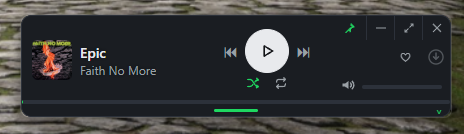
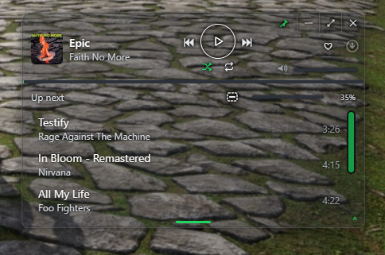

# Downtify for Windows

A Windows desktop client for a self-hosted [Downtify](https://github.com/henriquesebastiao/downtify) music server. Pair it once, and it keeps a local copy of your library index and the songs you choose, so it still opens and plays your music when the server is down.

Built with Tauri 2, React and Rust. Early and under active development; expect rough edges. Issues and ideas are welcome.

<p align="center">
  
  <br>
  
</p>

## What it does

- **Pairs** with your Downtify server using the same pairing code flow as the Android app. The device token lives in Windows Credential Manager.
- **Syncs** your songs, albums, artists, playlists and likes into a local SQLite index using the server's delta-sync API, so re-syncs are cheap.
- **Plays** your music: local file first, otherwise streamed from the server (original quality, or Opus 160 kbps when away from home). Player bar with seek, volume, shuffle, repeat, queue, likes, and Windows media keys.
- **Downloads** songs or whole playlists to your music folder (default `Music\Downtify`, changeable), mirroring the server's folder layout as ordinary tagged files other players can use. Three at a time, resumable. "Sync to this PC" on a playlist downloads it and pulls new additions after every sync.
- **Works offline**: with the server unreachable the app shows your local library and plays downloaded songs. Songs deleted on the server stay on your PC, marked, until you remove them.
- **Edits playlists** after an optional one-time sign-in: create, rename, add and remove songs, drag and drop between playlists, right-click menus everywhere, multi-select.
- **Shares playlists** (Downtify 3.7+): make a playlist private, shared with named people, or public; see "Shared with me" and "Public playlists" in the sidebar; follow public ones, save a copy of any you can open, and detach an imported playlist to make it editable.
- **Home** page with recently added albums and songs, recently played, and your playlists front and centre.
- **Mini player** (Ctrl+M): a small always-on-top bar with playback, heart, download, volume, an up-next drawer, and adjustable opacity that fades only the background so the song stays readable over whatever is behind it.
- **Frameless window**, light and dark themes, tray icon with close-to-tray and start-with-Windows, global search that also takes a Spotify or YouTube Music link to download.

Plays are reported to the server the way the web player does (queued while offline), and the server's Activity page sees what is playing.

## Install

Download the latest installer from the [Releases page](https://github.com/mrcool5556/downtify-windows/releases) and run it. It is unsigned, so Windows SmartScreen warns on first run. After that, updates arrive inside the app: a dot on Settings, release notes under About, and a one-click Update that checks the download against GitHub's checksum before installing. Windows 11 ships WebView2; on Windows 10 the installer fetches it if needed.

On first launch, type your server address, press Check, then open **Settings → Apps → Pair a phone** on the server's web page and enter the code.

## Build from source

Requirements: Node 20+, pnpm, Rust stable, the Tauri CLI (`cargo install tauri-cli --version '^2'`).

```bash
pnpm install
cargo tauri dev
```

Installer (NSIS) into `src-tauri/target/release/bundle/nsis`:

```bash
cargo tauri build
```

## Layout

- `src/` React frontend: `views/` (Setup, Library with Home, Downloads, Settings), `components/` (player bar, queue, context menu, download button), `player/store.ts` (the audio engine and queue), `downloads.ts`, `layout.tsx`.
- `src-tauri/src/` Rust: `server.rs` (Downtify client API), `db.rs` (local SQLite), `downloads.rs` (download manager), `media.rs` (local file and cover protocol), `smtc.rs` (Windows media keys), `commands.rs`, `settings.rs`.

Settings live in `%APPDATA%\dev.george.downtify\settings.json`, the library index in `%APPDATA%\dev.george.downtify\library.sqlite`, cached covers under `%LOCALAPPDATA%\dev.george.downtify`.

## Status

| Area | State |
|------|-------|
| Pairing, sync, browse | done |
| Player, media keys, queue | done |
| Downloads, keep-synced playlists, offline | done |
| Playlist editing, context menus, drag and drop | done |
| Playlist sharing, follow, save a copy, detach (server 3.7+) | done |
| Tray icon, close to tray, start with Windows | done |
| Mini player, frameless window, themes | done |
| In-app updates from GitHub releases | done |
| Lyrics, gapless, equaliser | not planned yet |

Sharing and detaching need Downtify 3.7.0 or newer on the server (added in response to [henriquesebastiao/downtify#465](https://github.com/henriquesebastiao/downtify/issues/465)). Older servers still work for everything else.

## Licence

AGPL-3.0. See [LICENSE](LICENSE).
